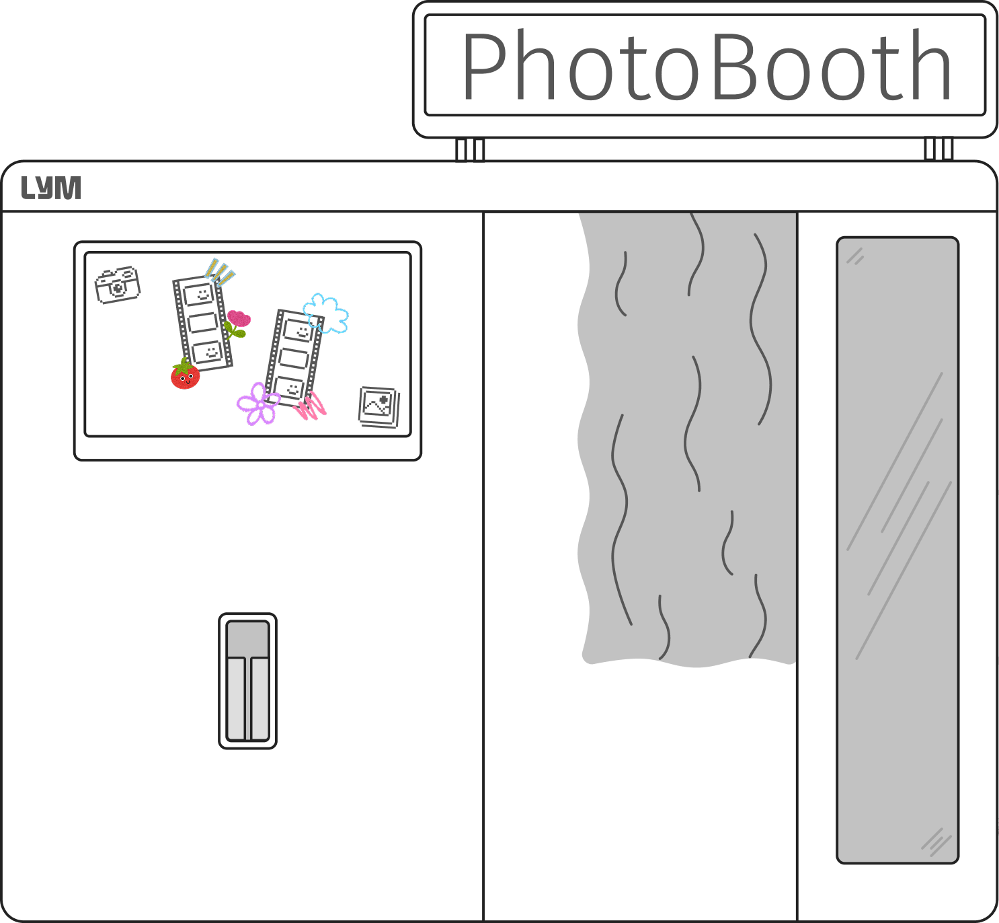
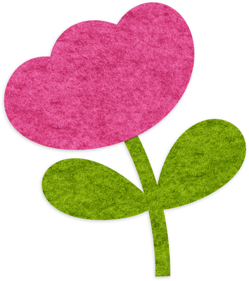
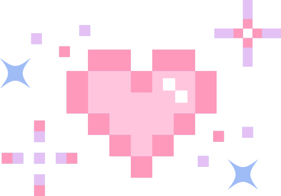
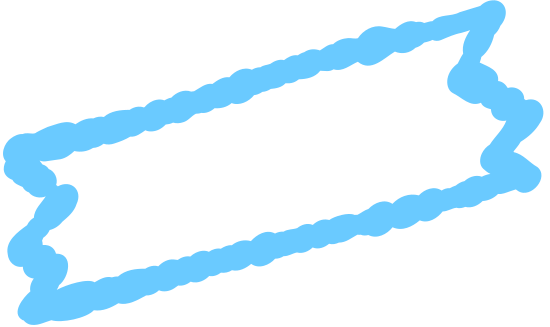
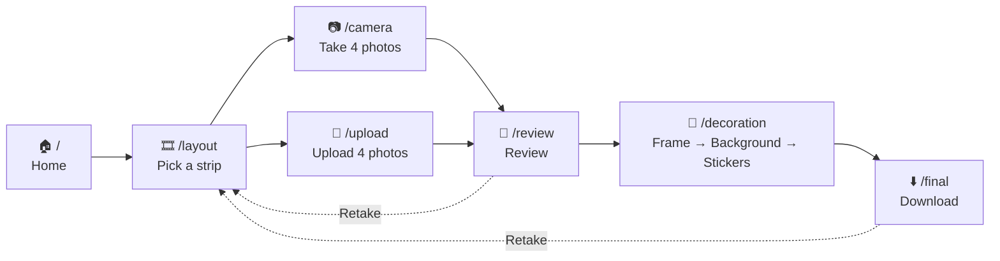
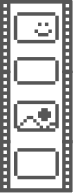
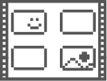
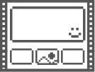
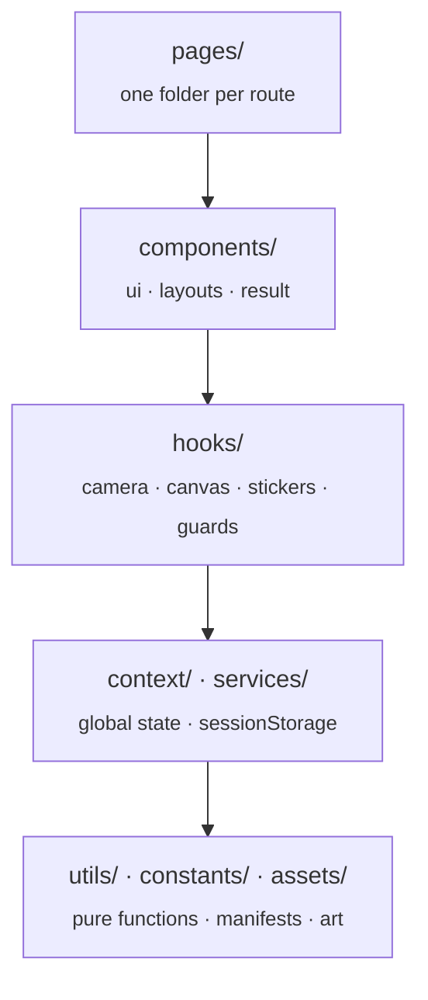
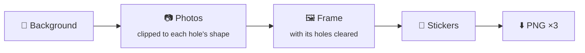

<div align="center">



# 📸 CuteBooth

**A photo booth in your browser.** Pick a strip, take (or upload) four photos,
decorate it with frames, backgrounds and stickers, and download it as a PNG.


-646CFF?logo=vite&logoColor=white&labelColor=222222>)


&nbsp;&nbsp;
&nbsp;&nbsp;
&nbsp;&nbsp;


</div>

---

## ✨ Features

|     | Feature               | Details                                                                        |
| --- | --------------------- | ------------------------------------------------------------------------------ |
| 🎞️  | **Three layouts**     | A classic strip, a 2×2 grid, or one hero photo with three small ones           |
| 📷  | **Camera or upload**  | Countdown, flash and a hint of which photo is next — or upload your own four   |
| 🖼️  | **Shaped frames**     | 24 SVG frames; photos are clipped to the real shape of each hole               |
| 🌈  | **Backgrounds**       | 46 illustrated backgrounds, a solid colour picked from a wheel, or your own    |
| 🧸  | **273 stickers**      | Four styles (3D, doodle, felt and pixel art) you can drag, rotate and resize   |
| 💾  | **Survives a reload** | Progress is saved to `sessionStorage`; hitting F5 doesn't send you back to go  |
| ⬇️  | **Hi-res download**   | The strip is composed on a `<canvas>` at ×3 resolution and downloaded as a PNG |
| 📱  | **Mobile**            | Every screen has a mobile version                                              |

## 🗺️ The flow



- **`/decoration` is a single route with three internal steps** (frame, background,
  stickers). The background step is mandatory.
- **`Retake` starts over**: it goes back to `/layout` and the decoration is lost.
- Every route has a _guard_: if you land on one without what it needs (e.g. `/review`
  with no photos), it redirects you to the right point in the flow.

## 🎞️ Layouts

<table>
  <tr>
    <th align="center"><br/>Classic</th>
    <th align="center"><br/>Wide</th>
    <th align="center"><br/>Spotlight</th>
  </tr>
  <tr>
    <td align="center">4 photos stacked<br/><sub>654 × 1911 px</sub></td>
    <td align="center">2 × 2 grid<br/><sub>1404 × 1257 px</sub></td>
    <td align="center">1 large + 3 small<br/><sub>1404 × 1257 px</sub></td>
  </tr>
</table>

The slot geometry is read **from the frame artwork itself**, not from the wireframe: the
frame is drawn on top of the photos, so it is the only source that can be right.
Numbers and method in [docs/contracts/layouts.md](docs/contracts/layouts.md).

## 🚀 Getting started

> Requirements: **Node.js 20.19+ or 22.12+** (required by Vite 8) and npm.

```bash
npm install
npm run dev        # http://localhost:5173
```

> [!NOTE]
> The camera only works in a **secure context** (`localhost` or HTTPS). If you open the
> app from your phone via your local network IP, the browser won't grant camera access
> and the app will offer to upload photos instead.

### Scripts

| Command                | What it does                                     |
| ---------------------- | ------------------------------------------------ |
| `npm run dev`          | Vite dev server with HMR                         |
| `npm run build`        | Type-checks (`tsc -b`) and builds for production |
| `npm run preview`      | Serves the production build locally              |
| `npm run lint`         | Runs ESLint over the whole project               |
| `npm run format`       | Prettier in write mode                           |
| `npm run format:check` | Prettier in check mode                           |

> [!IMPORTANT]
> **There is no test runner.** `npm run build` is the only automatic check, so "it
> works" means you tried it in the browser, not just that it compiles.

## 🧱 How it's built

### Layers



Arrows **only point down**. A component never calls `getUserMedia`,
`canvas.getContext` or `sessionStorage`: that lives in `hooks/`, `utils/` or `services/`.

### Structure

```text
src/
├── pages/            # one folder per route: <Name>Page.tsx + .module.css
├── components/
│   ├── ui/           # Button, Card, Modal, Loading, ColorWheel
│   ├── layouts/      # PageShell (+ AppFooter) and WebAppOldStyle, the retro window
│   └── result/       # PhotoResult, shared by /review and /final
├── context/          # PhotoBoothContext: one useReducer, the only global state
├── hooks/            # useCamera, useCanvas, useStickers, useRouteGuard
├── services/         # storageService: persistence in sessionStorage
├── utils/            # canvas composition, cropping, SVG and sticker geometry
├── constants/        # layouts and the frame, background and sticker manifests
├── types/            # state shape and action union
└── assets/           # 343 art files
```

### How the strip is composed



Frame SVGs carry their four holes as **closed paths filled with `#222222`**.
`frameArtUtils` turns them into clip masks for the photos and neutralises them in the
layer drawn on top; painting the SVG as-is would cover the photos with four dark blocks.

### Art without touching code

The manifests in `constants/` build their lists with `import.meta.glob`. To add a
frame, a background or a sticker, just drop the file into its folder under
`src/assets/`:

| Folder                                | Contents                              |
| ------------------------------------- | ------------------------------------- |
| `frames/{classic,wide,spotlight}/`    | 8 SVG frames per layout               |
| `backgrounds/classic/`                | 25 backgrounds for the vertical strip |
| `backgrounds/wide-and-spotlight/`     | 21 backgrounds for the landscape ones |
| `stickers/{3d,draw,felt,pixel}Style/` | 102 · 75 · 75 · 21 PNG stickers       |

Art rules in [docs/contracts/assets.md](docs/contracts/assets.md).

### Stack

- **React 19** with the **React Compiler**, wired by hand as a Babel preset in
  `vite.config.ts` via `@rolldown/plugin-babel`.
- **Vite 8** (Rolldown) and **TypeScript** with _project references_.
- **React Router 7** with `BrowserRouter`.
- **No state library**: a `useReducer` in Context (7 fields, 13 actions, an exhaustive
  `switch` with no `default` so `tsc` flags an unhandled action).
- **CSS Modules** per component and page, on top of the custom properties in
  `src/index.css`. Fonts: _Fira Code_ and _Pixelify Sans_.

## 📚 Documentation

The internal documentation lives in [`docs/`](docs/README.md) and is written in
Spanish. The product, including `alt` text, is in English.

| If you want to…                          | Read                                                               |
| ---------------------------------------- | ------------------------------------------------------------------ |
| Pick up the project                      | [docs/orchestration/KICKOFF.md](docs/orchestration/KICKOFF.md)     |
| Understand the architecture and its debt | [docs/ARCHITECTURE.md](docs/ARCHITECTURE.md)                       |
| See what's left and what blocks what     | [docs/orchestration/DAG.md](docs/orchestration/DAG.md)             |
| Avoid traps that already cost time       | [docs/orchestration/LECCIONES.md](docs/orchestration/LECCIONES.md) |
| Check each screen's scope and copy       | [`specs/`](specs/)                                                 |
| Look at the Figma design                 | [docs/design/FIGMA.md](docs/design/FIGMA.md)                       |
| Work with Claude Code agents             | [CLAUDE.md](CLAUDE.md)                                             |

## 🤝 Conventions

- Commit messages are written **in Spanish** and explain **why**, not what.
- Run `npm run format` on what you write.
- `npm run lint` has **one known error** in `context/PhotoBoothContext.tsx`
  (debt D8); it breaks nothing at runtime.
- Before adding a new page, look at `src/pages/layoutPage/LayoutPage.tsx`: it is the
  reference implementation of the `PageShell` + `WebAppOldStyle` pattern.

<div align="center">
<br/>
<sub>Made with 🩷, felt stickers and far too many frames.</sub>
</div>
