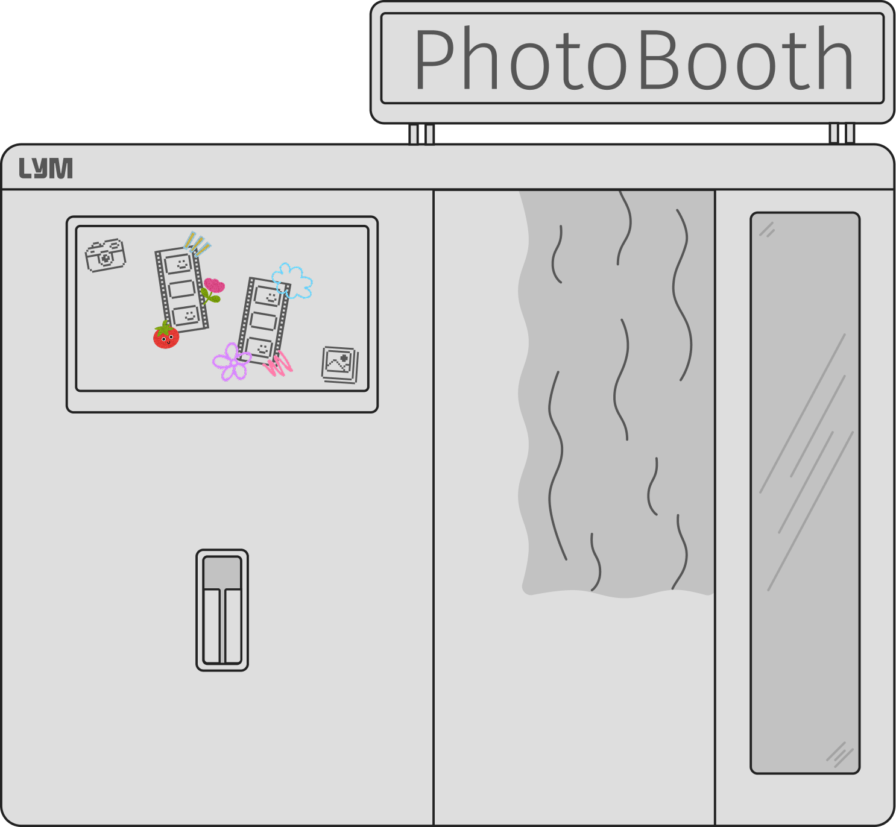
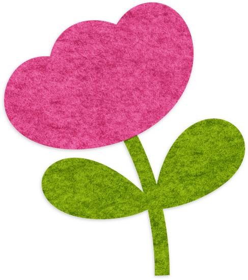
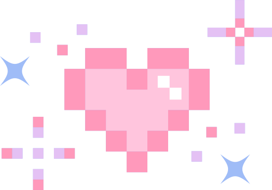
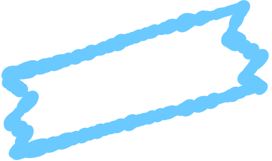
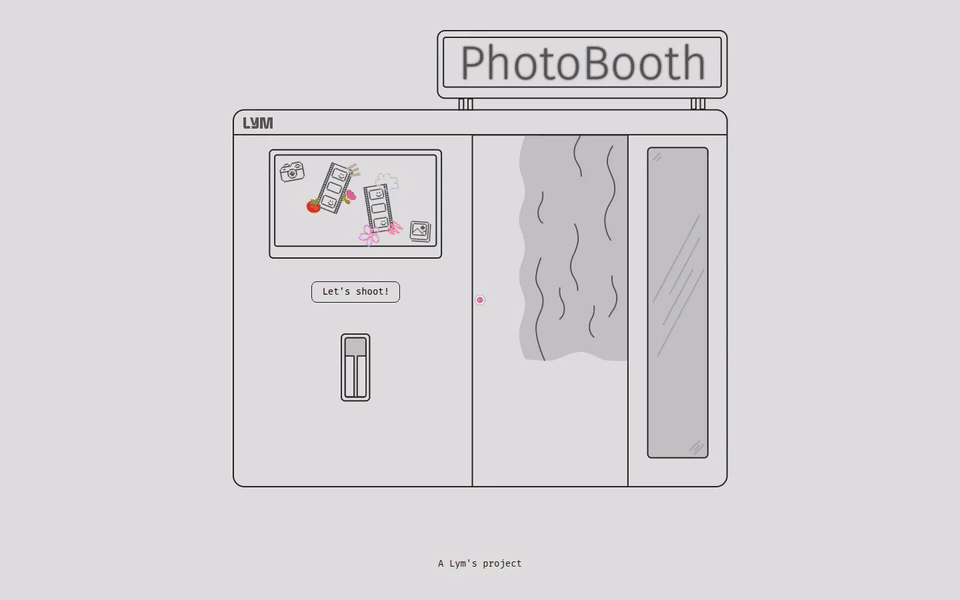

<div align="center">



# 📸 CuteBooth

**A photo booth in your browser.** Pick a strip, take (or upload) four photos,
decorate it with frames, backgrounds and stickers, and download it as a PNG.


&nbsp;&nbsp;
&nbsp;&nbsp;
&nbsp;&nbsp;


</div>

---

## 🎬 Demo

<div align="center">



</div>

## ✨ Features

- 🎞️ **Three layouts**: a classic strip, a 2×2 grid, or one big photo with three small ones.
- 📷 **Camera or upload**: take the photos with a countdown, or upload your own.
- 🖼️ **Frames and backgrounds**: 24 frames and 46 illustrated backgrounds, or pick a colour.
- 🧸 **Stickers**: 273 stickers in four styles that you can drag, rotate and resize.
- ⬇️ **Download**: get your strip as a high-resolution PNG.
- 📱 **Mobile friendly**: works on phones too.

## 🔒 Self-hosted & private

CuteBooth has no public instance: you run it yourself, on your own computer or your
own server. There is no backend and no account. Your photos never leave your
browser: the strip is put together and downloaded on your own device.

## 🛠️ Tech stack

- **React 19** with the React Compiler
- **TypeScript**
- **Vite 8**
- **React Router 7**
- **CSS Modules**

## 🚀 Getting started

> Requirements: **Node.js 20.19+ or 22.12+** and npm.

```bash
npm install
npm run dev        # http://localhost:5173
```

To build for production:

```bash
npm run build
npm run preview
```

> [!NOTE]
> The browser only allows the camera on `localhost` or HTTPS. If you open the app
> from another device using your local IP, you can still upload photos instead.

## 📄 License

The code and the original artwork (the photo booth illustrations, the drawings and
the LYM logo) are released under the
[PolyForm Noncommercial License 1.0.0](LICENSE): you can use, study and modify
them for **personal, non-commercial** purposes. Commercial use is not allowed.

The frames, backgrounds and stickers in `src/assets/frames/`,
`src/assets/backgrounds/` and `src/assets/stickers/` are **third-party works**. They
are not covered by this license and belong to their respective authors.

<div align="center">
<br/>
<sub>A lym's project 🩷</sub>
</div>
