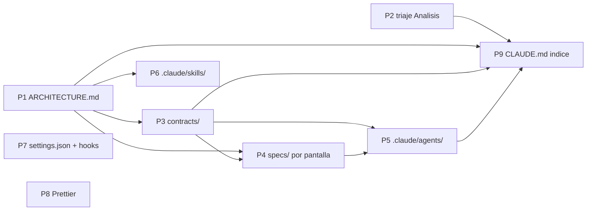
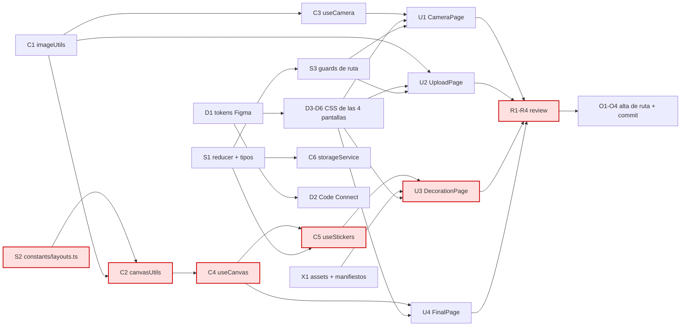

# DAG de trabajo

> Estado vivo. Se actualiza al cerrar cada nodo.
> Última revisión: 2026-07-25.

## 1. Por qué un DAG y no una lista de tareas

Una lista de tareas dice **qué** hay que hacer. Un DAG (grafo dirigido acíclico)
dice además **qué se puede hacer a la vez** y **qué está bloqueando a qué**. Con
agentes eso deja de ser teoría: cada nodo sin dependencias pendientes es un agente
que puedes lanzar ahora mismo en paralelo, y cada arista es una barrera que te
obliga a esperar.

La aciclicidad no es un deseo: la garantiza la regla de capas de
[../ARCHITECTURE.md](../ARCHITECTURE.md) §3. Las dependencias entre nodos son las
dependencias entre capas, y esas solo apuntan hacia abajo. **Si alguna vez
necesitas una arista que apunte hacia arriba, no tienes un problema de
planificación: tienes un error de diseño.**

## 2. Reglas del grafo

1. **Un nodo = una invocación de agente = un commit revisable.** Si no puedes
   revisar el nodo de una sentada, pártelo.
2. **Toda arista es un artefacto con nombre.** Si no puedes decir qué fichero o
   contrato viaja por la arista, la arista es falsa y estás serializando gratis.
3. **Un solo dueño por nodo.** El dueño sale de la matriz de propiedad de ficheros
   de [PLAN.md](PLAN.md) §4. Dos agentes en el mismo nodo = conflicto de escritura.
4. **Ancho y plano antes que estrecho y profundo.** Cada nivel de profundidad es
   una barrera, y una barrera cuesta tiempo de reloj.
5. **Criterio de aceptación explícito por nodo.** Sin él, "hecho" es una opinión.

## 3. DAG-0 · Preparación del repositorio

Esto va **antes** de orquestar nada. Detalle y justificación en [SETUP.md](SETUP.md).



| ID | Nodo | Dueño | Necesita | Estado |
|---|---|---|---|---|
| P1 | `docs/ARCHITECTURE.md` | orquestador | — | ✅ hecho |
| P2 | Triaje de `Analisis/` | orquestador | — | ✅ hecho |
| P3 | `docs/contracts/{state,layouts,design-tokens}.md` | orquestador | P1 | ✅ hecho |
| P4 | `specs/{camera,upload,review,decoration,final}.md` | orquestador | P1, P3 | ⬜ |
| P5 | `.claude/agents/*.md` (3 de fase 1) | orquestador | P3, P4 | ⬜ |
| P6 | `.claude/skills/nueva-pagina/` | orquestador | P1 | ⬜ |
| P7 | `.claude/settings.json` (hooks + permisos) | orquestador | — | ⬜ |
| P8 | Prettier + `.editorconfig` | orquestador | — | ⬜ |
| P9 | `CLAUDE.md` como índice | orquestador | P1, P3, P5 | 🟡 parcial |

## 4. DAG-1 · Construcción del producto



### Nodos

| ID | Nodo | Dueño | Necesita | Produce | Aceptación | Estado |
|---|---|---|---|---|---|---|
| **S2** | Geometría y labels de los 3 layouts | `booth-state` | — | `constants/layouts.ts` | Contrato y checklist en [../contracts/layouts.md](../contracts/layouts.md) | ⬜ |
| **S1** | Reducer completo + tipos | `booth-state` | — | `context/PhotoBoothContext.tsx`, `types/` | **10** acciones (`CLEAR_PHOTOS` es la nueva, para el "repetir" de `/review`) y checklist de [../contracts/state.md](../contracts/state.md) | ⬜ |
| **S3** | Guards de ruta | `booth-state` | S1 | `hooks/useRouteGuard.ts` | Tabla de guards y checklist de [../contracts/state.md](../contracts/state.md) | ⬜ |
| **C1** | Utilidades de imagen | `canvas-media` | — | `utils/imageUtils.ts` | resize, dataURL↔Blob, sin fugas | ⬜ |
| **C2** | Composición sobre canvas | `canvas-media` | S2, C1 | `utils/canvasUtils.ts` | Dibuja los 3 layouts a 600×1800 nítido en pantalla retina | ⬜ |
| **C3** | Hook de cámara | `canvas-media` | C1 | `hooks/useCamera.ts` | Cuenta atrás 3-2-1, corta los tracks al desmontar, gestiona permiso denegado | ⬜ |
| **C4** | Hook de canvas | `canvas-media` | C2 | `hooks/useCanvas.ts` | `draw(state)` + `exportAsBlob()` | ⬜ |
| **C5** | Hook de stickers | `canvas-media` | S1, C4 | `hooks/useStickers.ts` | Arrastre correcto con escalado px-CSS ↔ px-canvas | ⬜ |
| **C6** | Persistencia temporal | `canvas-media` | S1 | `services/storageService.ts` | Sobrevive a un refresco sin reventar la cuota | ⬜ |
| **D1** | Delta de tokens **code-first** | `figma-design-sync` | — | §4 de `contracts/design-tokens.md`, `index.css` | El contrato, el catálogo de las 21 properties y la deuda T1-T8 ya están escritos (P3). D1 **rellena §4** y resuelve T1-T3. Checklist en [../contracts/design-tokens.md](../contracts/design-tokens.md) | ⬜ |
| **D2** | Code Connect de los 5 componentes | `figma-design-sync` | D1 | `*.figma.ts` | `get_design_context` devuelve `<Button>`, no `<div>` | ⬜ |
| **D3** | CSS CameraPage · nodo `91:954` | `figma-design-sync` | D1 | `CameraPage.module.css` | **Lote único D3-D7**, ver §6 | ⬜ |
| **D4** | CSS UploadPage · nodos `91:1168`, `91:1202`, `91:1223` | `figma-design-sync` | D1 | `UploadPage.module.css` | No son 3 estados: son los 3 layouts | ⬜ |
| **D5** | CSS DecorationPage · nodos `102:319`, `103:382` | `figma-design-sync` | D1 | `DecorationPage.module.css` | 🔴 **BLOQUEADO**: falta confirmar que esos nodos son Decoration, y no hay panel de fondos ni stickers | 🔴 |
| **D6** | CSS FinalPage · nodo `2074:52` | `figma-design-sync` | D1, D7 | `FinalPage.module.css` | Idéntica a D7: reutilizar, no rehacer | ⬜ |
| **D7** | CSS SelectedPicturesPage · nodo `91:1346` | `figma-design-sync` | D1 | `PhotoResult.module.css`, `ReviewPage.module.css` | El CSS del bloque de resultado es **compartido** con D6 | ⬜ |
| **C7** | Componente `Loading` · nodo `91:1283` | `ui-composer` | D1 | `components/ui/Loading.tsx` | Spinner, no ruta. Lo usan las páginas que esperan | ⬜ |
| **X1** | Assets + manifiestos | `asset-pipeline` | — | `assets/**`, `constants/{stickers,backgrounds}.ts` | IDs tipados, carpetas vacías llenas | ⬜ |
| **U1** | CameraPage `/camera` | `ui-composer` | S1,S3,C3,C7,D3 | página + `components/camera/` | 4 fotos → `/review` | ⬜ |
| **U2** | UploadPage `/upload` | `ui-composer` | S1,S3,C1,C7,D4 | página + `components/upload/` | Valida tipo y cantidad → `/review` | ⬜ |
| **U5** | **SelectedPicturesPage `/review`** | `ui-composer` | S1,S3,C4,D7 | página + `components/result/PhotoResult.tsx` | Muestra el strip; seguir → `/decoration`, repetir → volver al origen. **`PhotoResult` es compartido con U4** | ⬜ |
| **U3** | DecorationPage `/decoration` | `ui-composer` | S1,S3,C4,C5,D5,X1 | página + `components/decoration/` | 🔴 bloqueado por D5 | 🔴 |
| **U4** | FinalPage `/final` | `ui-composer` | S1,S3,C4,D6,**U5** | página | Reutiliza `PhotoResult` de U5. Descarga PNG + rehacer | ⬜ |
| **R\*** | Revisión por pantalla | `booth-reviewer` | U* correspondiente | hallazgos | Build, lint, capas, a11y, fidelidad estructural | ⬜ |
| **O\*** | Alta de ruta + commit | orquestador | R* correspondiente | `App.tsx` | Sin imports muertos | ⬜ |

### 4.1 · Estado tras el reinventariado de Figma (2026-07-26)

Detalle en [../design/FIGMA.md](../design/FIGMA.md).

- **D1 cambia de dirección.** `get_variable_defs` devuelve `{}`: no hay variables
  en el fichero, así que no hay nada que sincronizar. El código es la fuente de
  verdad de los tokens. El catálogo de las 21 custom properties y las reglas de
  mapeo se escribieron en P3; a D1 le queda el **delta**: proponer los tokens que
  falten tras ver las cinco pantallas, y cerrar la deuda T1-T3.
- **D6 desbloqueado.** La pantalla Final existe: `2074:52`.
- **U5 es nuevo.** `/review` entra en alcance. `PhotoResult` se comparte con U4.
- **C7 es nuevo.** `Loading` es un componente, no una ruta.
- **S2 ya tiene geometría real** — de las pantallas Upload. Ver
  [../contracts/layouts.md](../contracts/layouts.md).
- **D5 y U3 bloqueados.** No hay pantalla Decoration en el fichero. Ver
  [KICKOFF.md](KICKOFF.md) §6.
- **El fichero es de wireframes.** El CSS que salga de D3-D7 es estructura, no
  acabado. `booth-reviewer` no puede exigir fidelidad de píxel contra un
  wireframe, ni nada fuera de los 1440 px de los artboards.

## 5. Camino crítico

```
nominal    S2 → C2 → C4 → C5 → U3 → R → O      (7 niveles, BLOQUEADO en U3)
efectivo   S2 → C2 → C4 → U5 → U4 → R → O      (7 niveles, transitable)
```

Mientras D5/U3 sigan bloqueados por la Decoration que falta, **C5 (`useStickers`)
sale del camino crítico**: su único consumidor es U3. Bájalo de prioridad y no
gastes el agente Opus en él hasta que la pantalla exista.

**Dos consecuencias que no son obvias sin dibujar el grafo:**

**a) La raíz del camino crítico es `constants/layouts.ts`.** Un fichero de ~40
líneas de geometría bloquea el 60 % del proyecto. Hazlo el **primer** nodo, antes
incluso que el reducer — que, contra la intuición, no está en el camino crítico.

**b) `figma-design-sync` no está en el camino crítico en ningún punto.** D1 no
depende de nada y D3-D6 solo dependen de D1. Eso significa que todo el trabajo de
diseño se puede producir por delante, en lote, y quedarse esperando. Es una suerte,
porque es el único agente con rate limit (plan Figma student).

**Esto invalida el flujo "un pull de Figma por pantalla".** Sustituido por §6.

## 6. Regla de lote para Figma

El CSS de las pantallas **D3, D4 y D5** (D6 está bloqueado) se produce **en una
sola sesión** de `figma-design-sync`, justo después de D1, y se cachea en
`docs/design/<pantalla>.md`. Son 6 node IDs contando los estados de Upload y las
dos vistas de Decoration — todos listados en [../design/FIGMA.md](../design/FIGMA.md).

Razones, por orden de peso:

1. Nunca está en el camino crítico → no hay motivo para hacerlo bajo demanda.
2. El plan student tiene rate limit → menos llamadas, más grandes, es más seguro.
3. `get_design_context` es caro en tokens → una pasada con contexto caliente
   cuesta menos que cuatro pasadas frías.
4. Las pantallas del mismo fichero comparten decisiones visuales → hacerlas juntas
   produce CSS más coherente.

Antes de cada `get_design_context`, sondear con `get_metadata` **sobre el frame
concreto**, que es barato. **Nunca sobre la página `0:1`**: son 123k caracteres y
revienta el contexto — comprobado el 2026-07-26.

## 7. Cómo se ejecuta

**El bucle del orquestador**, cada vez que se cierra un nodo:

1. Marcar el nodo como ✅ en la tabla y commitear.
2. Calcular el **conjunto listo**: nodos ⬜ con todas sus dependencias en ✅.
3. Lanzar del conjunto listo, priorizando el camino crítico.
4. Esperar. Volver a 1.

**Límite de concurrencia: 2 agentes.** No es un límite técnico, es tu ancho de banda
para revisar. El DAG te dice qué *puede* ir en paralelo; tú decides cuánto va de
verdad. La ola 1 tiene 5 nodos listos a la vez y no debes lanzar 5.

**Orden sugerido con ese límite:**

| Ola | Lanzar | Por qué |
|---|---|---|
| 1 | **S2** + D1 | S2 abre el camino crítico; D1 no depende de nada y libera todo Figma |
| 2 | S1 + C1 | Ambos raíz, ambos desbloquean mucho |
| 3 | **C2** + D3-D7 (lote) | C2 es camino crítico; Figma en lote y ya no vuelve a molestar |
| 4 | **C4** + C3 | |
| 5 | **U5** + C7 | `/review` desbloquea `PhotoResult`, que U4 reutiliza |
| 6 | **U4** + U1 | |
| 7 | U2 + X1 | X1 puede colarse antes en cualquier hueco |
| 8 | R* → O* | Revisión y alta de rutas |
| — | C5, D5, U3 | 🔴 En cuanto se resuelva la Decoration que falta |

En **negrita**, el camino crítico. Si un día solo puedes atender a un agente, que
sea el del camino crítico.

## 8. Mantenimiento del grafo

- El grafo se edita cuando cambia la realidad, no cuando cambia la intención.
- Nodo que se parte → nuevos IDs con sufijo (`C2a`, `C2b`), nunca reciclar un ID.
- Si un nodo se bloquea por algo externo (falta la URL de Figma, falta el arte),
  márcalo 🔴 con el motivo. Un bloqueo silencioso se convierte en un nodo olvidado.
- Si aparece una arista hacia arriba en el grafo de capas: parar y rediseñar.
  Nunca resolverlo con un import cruzado.

### Si algún día quieres automatizar el bucle

La herramienta `Workflow` de Claude Code codifica este mismo grafo en JavaScript
(`parallel()` para las olas, `pipeline()` para las cadenas sin barrera). Es una
opción real, pero **no para este tamaño**: 20 nodos con un revisor humano de ancho
de banda 2 no justifican perder el control manual entre nodos. Reevaluar solo si el
proyecto crece mucho o si hay que repetir el grafo entero (por ejemplo, migrar
todas las páginas a un patrón nuevo).
