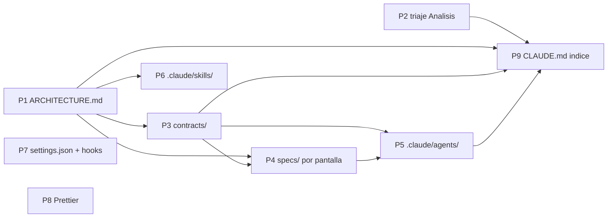
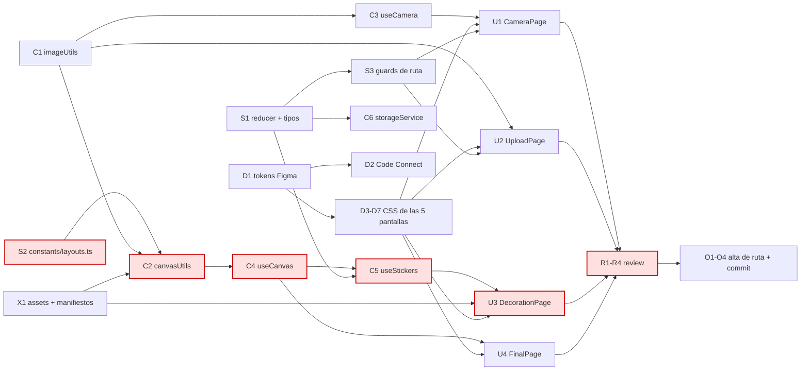

# DAG de trabajo

> Estado vivo. Se actualiza al cerrar cada nodo.
> Última revisión: 2026-07-27. **Doce nodos cerrados**: S1, S2, S3, C1, C2, D1, D3-D7, X1.
> Lo que queda abierto está en §9.

## 1. Por qué un DAG y no una lista de tareas

Una lista de tareas dice **qué** hay que hacer. Un DAG (grafo dirigido acíclico)
dice además **qué se puede hacer a la vez** y **qué está bloqueando a qué**. Con
agentes eso deja de ser teoría: cada nodo sin dependencias pendientes es un agente
que puedes lanzar ahora mismo en paralelo, y cada arista es una barrera que te
obliga a esperar.

La aciclicidad no es un deseo: la garantiza la regla de capas de
[../ARCHITECTURE.md](../ARCHITECTURE.md) §3. Las dependencias entre nodos son las
dependencias entre capas, y esas solo apuntan hacia abajo. **Si alguna vez
necesitas una arista que apunte hacia arriba, no tienes un problema de
planificación: tienes un error de diseño.**

## 2. Reglas del grafo

1. **Un nodo = una invocación de agente = un commit revisable.** Si no puedes
   revisar el nodo de una sentada, pártelo.
2. **Toda arista es un artefacto con nombre.** Si no puedes decir qué fichero o
   contrato viaja por la arista, la arista es falsa y estás serializando gratis.
3. **Un solo dueño por nodo.** El dueño sale de la matriz de propiedad de ficheros
   de [PLAN.md](PLAN.md) §4. Dos agentes en el mismo nodo = conflicto de escritura.
4. **Ancho y plano antes que estrecho y profundo.** Cada nivel de profundidad es
   una barrera, y una barrera cuesta tiempo de reloj.
5. **Criterio de aceptación explícito por nodo.** Sin él, "hecho" es una opinión.

## 3. DAG-0 · Preparación del repositorio

Esto va **antes** de orquestar nada. Detalle y justificación en [SETUP.md](SETUP.md).



| ID  | Nodo                                               | Dueño       | Necesita   | Estado                                                                             |
| --- | -------------------------------------------------- | ----------- | ---------- | ---------------------------------------------------------------------------------- |
| P1  | `docs/ARCHITECTURE.md`                             | orquestador | —          | ✅ hecho                                                                           |
| P2  | Triaje de `Analisis/`                              | orquestador | —          | ✅ hecho                                                                           |
| P3  | `docs/contracts/{state,layouts,design-tokens}.md`  | orquestador | P1         | ✅ hecho · más `assets.md`, que no estaba previsto                                 |
| P4  | `specs/{camera,upload,review,decoration,final}.md` | orquestador | P1, P3     | ✅ hecho                                                                           |
| P5  | `.claude/agents/*.md` (3 de fase 1)                | orquestador | P3, P4     | ✅ hecho                                                                           |
| P6  | `.claude/skills/nueva-pagina/`                     | orquestador | P1         | ✅ hecho                                                                           |
| P7  | `.claude/settings.json` (hooks + permisos)         | orquestador | —          | ✅ hecho                                                                           |
| P8  | Prettier + `.editorconfig`                         | orquestador | —          | ✅ hecho · pasada aplicada el 2026-07-26: 41 ficheros en un commit solo de formato |
| P9  | `CLAUDE.md` como índice                            | orquestador | P1, P3, P5 | ✅ hecho                                                                           |

**DAG-0 cerrado el 2026-07-26**, y con él las dos dudas que quedaban: la geometría la
manda el arte de los marcos ([../contracts/layouts.md](../contracts/layouts.md)) y las
muestras del menú se generan del propio marco
([../contracts/assets.md](../contracts/assets.md)).

**DAG-0 no dejó nada bloqueado**, y DAG-1 arrancó por S2 como estaba previsto.

## 4. DAG-1 · Construcción del producto



### Nodos

| ID      | Nodo                                                   | Dueño               | Necesita             | Produce                                                                  | Aceptación                                                                                                                                                                                                                                                       | Estado |
| ------- | ------------------------------------------------------ | ------------------- | -------------------- | ------------------------------------------------------------------------ | ---------------------------------------------------------------------------------------------------------------------------------------------------------------------------------------------------------------------------------------------------------------- | ------ |
| **S2**  | Geometría y labels de los 3 layouts                    | `booth-state`       | —                    | `constants/layouts.ts`                                                   | Geometría ya extraída del arte. Contrato y checklist en [../contracts/layouts.md](../contracts/layouts.md)                                                                                                                                                       | ✅     |
| **S1**  | Reducer completo + tipos                               | `booth-state`       | —                    | `context/PhotoBoothContext.tsx`, `types/`                                | 6 campos y **11** acciones (`SET_FRAME` y `CLEAR_PHOTOS` son las nuevas) + checklist de [../contracts/state.md](../contracts/state.md)                                                                                                                           | ✅     |
| **S3**  | Guards de ruta                                         | `booth-state`       | S1                   | `hooks/useRouteGuard.ts`                                                 | Tabla de guards y checklist de [../contracts/state.md](../contracts/state.md)                                                                                                                                                                                    | ✅     |
| **C1**  | Utilidades de imagen                                   | `canvas-media`      | —                    | `utils/imageUtils.ts`                                                    | resize, dataURL↔Blob, sin fugas                                                                                                                                                                                                                                  | ✅     |
| **C2**  | Composición sobre canvas                               | `canvas-media`      | S2, C1, **X1**       | `utils/canvasUtils.ts`                                                   | Dibuja los 3 layouts a la resolución de `layouts.ts`, nítido en retina, pinta el SVG del marco encima y recorta los huecos no rectangulares                                                                                                                      | ✅     |
| **C3**  | Hook de cámara                                         | `canvas-media`      | C1                   | `hooks/useCamera.ts`                                                     | Cuenta atrás 3-2-1, corta los tracks al desmontar, gestiona permiso denegado                                                                                                                                                                                     | ⬜     |
| **C4**  | Hook de canvas                                         | `canvas-media`      | C2                   | `hooks/useCanvas.ts`                                                     | `draw(state)` + `exportAsBlob()`                                                                                                                                                                                                                                 | ⬜     |
| **C5**  | Hook de stickers                                       | `canvas-media`      | S1, C4               | `hooks/useStickers.ts`                                                   | Arrastre correcto con escalado px-CSS ↔ px-canvas                                                                                                                                                                                                                | ⬜     |
| **C6**  | Persistencia temporal                                  | `canvas-media`      | S1                   | `services/storageService.ts`                                             | Sobrevive a un refresco sin reventar la cuota                                                                                                                                                                                                                    | ⬜     |
| **D1**  | Delta de tokens **code-first**                         | `figma-design-sync` | —                    | `Button.module.css` · §4 de `contracts/design-tokens.md`                 | T1 y T2 resueltos. **T3 y §4 se cobran en el lote D3-D7**, por instrucción del propio contrato: sin las cinco pantallas no hay evidencia. Cero llamadas a Figma gastadas aquí                                                                                    | ✅     |
| **D2**  | Code Connect de los 5 componentes                      | `figma-design-sync` | D1                   | `*.figma.ts`                                                             | `get_design_context` devuelve `<Button>`, no `<div>`                                                                                                                                                                                                             | ⬜     |
| **D3**  | CSS CameraPage · nodo `91:954`                         | `figma-design-sync` | D1                   | `CameraPage.module.css`                                                  | **Lote único D3-D7**, ver §6                                                                                                                                                                                                                                     | ✅     |
| **D4**  | CSS UploadPage · nodos `91:1168`, `91:1202`, `91:1223` | `figma-design-sync` | D1                   | `UploadPage.module.css`                                                  | No son 3 estados: son los 3 layouts                                                                                                                                                                                                                              | ✅     |
| **D5**  | CSS DecorationPage · nodo `102:319`                    | `figma-design-sync` | D1                   | `DecorationPage.module.css`                                              | **Desbloqueado el 2026-07-26.** `103:382` es duplicado exacto: ignorarlo. Un solo panel + preview + botones sirve a los **tres pasos**; los pasos 2 y 3 no están dibujados y usan esa plantilla. Ver [../../specs/decoration.md](../../specs/decoration.md)      | ✅     |
| **D6**  | CSS FinalPage · nodo `2074:52`                         | `figma-design-sync` | D1, D7               | `FinalPage.module.css`                                                   | Idéntica a D7: reutilizar, no rehacer                                                                                                                                                                                                                            | ✅     |
| **D7**  | CSS SelectedPicturesPage · nodo `91:1346`              | `figma-design-sync` | D1                   | `PhotoResult.module.css`, `ReviewPage.module.css`                        | El CSS del bloque de resultado es **compartido** con D6                                                                                                                                                                                                          | ✅     |
| **C7**  | Componente `Loading` · nodo `91:1283`                  | `ui-composer`       | D1                   | `components/ui/Loading.tsx`                                              | Spinner, no ruta. Lo usan las páginas que esperan                                                                                                                                                                                                                | ⬜     |
| **X1**  | Manifiestos de assets                                  | `canvas-media`      | —                    | `constants/{frames,stickers,backgrounds}.ts`, renombrados en `assets/**` | **El arte ya está en el repo** (24 marcos, 46 fondos, 273 pegatinas, 38 MB): no se baja nada de Figma. Las muestras del menú se generan del propio marco, así que no falta ningún dato. Contrato y checklist en [../contracts/assets.md](../contracts/assets.md) | ✅     |
| **U1**  | CameraPage `/camera`                                   | `ui-composer`       | S1,S3,C3,C7,D3       | página + `components/camera/`                                            | Checklist en [../../specs/camera.md](../../specs/camera.md)                                                                                                                                                                                                      | ⬜     |
| **U2**  | UploadPage `/upload`                                   | `ui-composer`       | S1,S3,C1,C7,D4       | página + `components/upload/`                                            | Clic por hueco, `Continue` deshabilitado hasta las 4. Checklist en [../../specs/upload.md](../../specs/upload.md)                                                                                                                                                | ⬜     |
| **U5**  | **SelectedPicturesPage `/review`**                     | `ui-composer`       | S1,S3,C4,D7          | página + `components/result/PhotoResult.tsx`                             | **`PhotoResult` es compartido con U4.** Checklist en [../../specs/review.md](../../specs/review.md)                                                                                                                                                              | ⬜     |
| **U3**  | DecorationPage `/decoration`                           | `ui-composer`       | S1,S3,C4,C5,C7,D5,X1 | página + `components/decoration/`                                        | **Una ruta, tres pasos** (Frames → Backgrounds → Icons) con el paso en estado local. Checklist en [../../specs/decoration.md](../../specs/decoration.md)                                                                                                         | ⬜     |
| **U4**  | FinalPage `/final`                                     | `ui-composer`       | S1,S3,C4,D6,**U5**   | página                                                                   | Reutiliza `PhotoResult` de U5. Checklist en [../../specs/final.md](../../specs/final.md)                                                                                                                                                                         | ⬜     |
| **R\*** | Revisión por pantalla                                  | `booth-reviewer`    | U* correspondiente   | hallazgos                                                                | Build, lint, capas, a11y, fidelidad estructural                                                                                                                                                                                                                  | ⬜     |
| **O\*** | Alta de ruta + commit                                  | orquestador         | R* correspondiente   | `App.tsx`                                                                | Sin imports muertos                                                                                                                                                                                                                                              | ⬜     |

### 4.1 · Ola 1-2 cerrada, y el camino crítico se para en X1 (2026-07-26)

**S2, C1, S1 y D1 verificados y cerrados.** La geometría de `constants/layouts.ts` se
comprobó contra `classic/Frame 7.svg` rect a rect (regla `x-0.97`, `w+1.94`, ordenado por
`y`) y coincide con las tablas de [../contracts/layouts.md](../contracts/layouts.md).

**D1 no gastó ni una llamada a Figma, y es lo correcto.** El contrato de tokens dice que
§4 se rellena en el lote D3-D7 "y no antes", y la fila T3 dice que `--primary-color` se
comprueba en esas mismas pantallas. Así que D1 se quedó en lo que sí era decidible desde
el código: T1 (`border: 2px` → `var(--border-width)`) y T2 (`gap: 10.514px` → `10px`).
**T3 y §4 viajan al lote D3-D7**, que es su sitio, y las llamadas ahorradas se las queda
el lote — la cuenta de Figma es plan student con rate limit.

**El lint no está verde, y no es de esta ola.** `npm run lint` da un error de
`react-refresh/only-export-components` en `PhotoBoothContext.tsx` que ya daba en `HEAD`
antes de S1 (comprobado). Está anotado como deuda **D8** en
[../ARCHITECTURE.md](../ARCHITECTURE.md) §7 con su dueño y su motivo. `npm run build`,
que es la puerta real, está limpio.

Dos correcciones del grafo, que se editan porque cambió la realidad, no la intención:

- **`X1 --> C2` faltaba en el mermaid.** La tabla de nodos siempre dijo que C2 necesita
  X1; el diagrama dibujaba X1 aislado. Con la arista, **X1 entra en el camino crítico**:
  el arte de los marcos es el que C2 dibuja encima de las fotos.
- **Por tanto §7 tenía las olas mal ordenadas**: proponía C2 en la ola 3 y X1 en la 7,
  que es imposible. X1 sube a la ola 3, delante de C2.

**Y X1 no tenía agente.** `asset-pipeline` es de fase 3 ([PLAN.md](PLAN.md) §11) y nunca
llegó a existir. **Resuelto el mismo día reasignando X1 a `canvas-media`**, que es quien
consume los manifiestos para dibujar. Al implementarlo se vio que el nodo era mucho más
pequeño de lo que parecía —`import.meta.glob` genera las listas— así que el agente
dedicado nunca hizo falta.

**Un punto de la checklist de S2 no es de S2.** `frames/square/` → `frames/spotlight/`
está en `src/assets/**`, que no era de `booth-state`: hizo bien en no
tocarlo. El renombrado ya figura en §Renombrados de
[../contracts/assets.md](../contracts/assets.md), así que se cobra en **X1**, no aquí.
Ningún `.ts`, `.tsx` ni `.css` menciona `square`: no hay nada roto mientras tanto.

### 4.2 · Estado tras el reinventariado de Figma (2026-07-26)

Detalle en [../design/FIGMA.md](../design/FIGMA.md).

- **D1 cambia de dirección.** `get_variable_defs` devuelve `{}`: no hay variables
  en el fichero, así que no hay nada que sincronizar. El código es la fuente de
  verdad de los tokens. El catálogo de las 21 custom properties y las reglas de
  mapeo se escribieron en P3; a D1 le queda el **delta**: proponer los tokens que
  falten tras ver las cinco pantallas, y cerrar la deuda T1-T3.
- **D6 desbloqueado.** La pantalla Final existe: `2074:52`.
- **U5 es nuevo.** `/review` entra en alcance. `PhotoResult` se comparte con U4.
- **C7 es nuevo.** `Loading` es un componente, no una ruta.
- **S2 ya tiene geometría real** — de las pantallas Upload. Ver
  [../contracts/layouts.md](../contracts/layouts.md).
- **D5 y U3 DESBLOQUEADOS el 2026-07-26.** La pantalla existía sin nombrar: es
  `102:319`, hoy "Decorarion". Y no es una pantalla, son **tres pasos en una sola
  ruta** — Frames → Backgrounds → Icons. Los pasos 2 y 3 no están dibujados y se
  construyen con la plantilla del 1. Detalle en
  [../../specs/decoration.md](../../specs/decoration.md).
- **Los frames son un campo de estado nuevo.** Un marco es un conjunto temático
  de 4 recortes, uno por hueco. Añade `frame` al estado y `SET_FRAME` a las
  acciones: once en total. Ver [../contracts/state.md](../contracts/state.md).
- **El fichero es de wireframes.** El CSS que salga de D3-D7 es estructura, no
  acabado. `booth-reviewer` no puede exigir fidelidad de píxel contra un
  wireframe, ni nada fuera de los 1440 px de los artboards.

## 5. Camino crítico

```
S2 → C2 → C4 → C5 → U3 → R → O      (7 niveles, transitable de punta a punta)
```

Desde que Decoration se desbloqueó (2026-07-26) hay **un solo** camino crítico y
`C5` (`useStickers`) vuelve a estar dentro: su consumidor U3 ya existe. La rama
`C4 → U5 → U4` tiene la misma longitud y comparte los tres primeros nodos, así que
no compite: se resuelve sola por el camino.

**Dos consecuencias que no son obvias sin dibujar el grafo:**

**a) La raíz del camino crítico es `constants/layouts.ts`.** Un fichero de ~40
líneas de geometría bloquea el 60 % del proyecto. Hazlo el **primer** nodo, antes
incluso que el reducer — que, contra la intuición, no está en el camino crítico.

**b) `figma-design-sync` no está en el camino crítico en ningún punto.** D1 no
depende de nada y D3-D6 solo dependen de D1. Eso significa que todo el trabajo de
diseño se puede producir por delante, en lote, y quedarse esperando. Es una suerte,
porque es el único agente con rate limit (plan Figma student).

**Esto invalida el flujo "un pull de Figma por pantalla".** Sustituido por §6.

## 6. Regla de lote para Figma

El CSS de las pantallas **D3-D7** se produce **en una
sola sesión** de `figma-design-sync`, justo después de D1, y se cachea en
`docs/design/<pantalla>.md`. Son 6 node IDs contando los estados de Upload y las
dos vistas de Decoration — todos listados en [../design/FIGMA.md](../design/FIGMA.md).

Razones, por orden de peso:

1. Nunca está en el camino crítico → no hay motivo para hacerlo bajo demanda.
2. El plan student tiene rate limit → menos llamadas, más grandes, es más seguro.
3. `get_design_context` es caro en tokens → una pasada con contexto caliente
   cuesta menos que cuatro pasadas frías.
4. Las pantallas del mismo fichero comparten decisiones visuales → hacerlas juntas
   produce CSS más coherente.

Antes de cada `get_design_context`, sondear con `get_metadata` **sobre el frame
concreto**, que es barato. **Nunca sobre la página `0:1`**: son 123k caracteres y
revienta el contexto — comprobado el 2026-07-26.

## 7. Cómo se ejecuta

**El bucle del orquestador**, cada vez que se cierra un nodo:

1. Marcar el nodo como ✅ en la tabla y commitear.
2. Calcular el **conjunto listo**: nodos ⬜ con todas sus dependencias en ✅.
3. Lanzar del conjunto listo, priorizando el camino crítico.
4. Esperar. Volver a 1.

**Límite de concurrencia: 2 agentes.** No es un límite técnico, es tu ancho de banda
para revisar. El DAG te dice qué _puede_ ir en paralelo; tú decides cuánto va de
verdad. La ola 1 tiene 5 nodos listos a la vez y no debes lanzar 5.

**Orden sugerido con ese límite:**

| Ola | Lanzar                | Por qué                                                                        |
| --- | --------------------- | ------------------------------------------------------------------------------ |
| 1   | **S2** ✅ + D1        | S2 abre el camino crítico; D1 no depende de nada y libera todo Figma           |
| 2   | S1 + C1 ✅            | Ambos raíz, ambos desbloquean mucho                                            |
| 3   | **X1** + D3-D7 (lote) | **X1 subió aquí**: es la dependencia que le falta a C2. Figma en lote, y listo |
| 4   | **C2** + C3           | C2 es camino crítico en cuanto X1 aterrice                                     |
| 5   | **C4** + C7           |                                                                                |
| 6   | **C5** + U5           | `/review` desbloquea `PhotoResult`, que U4 reutiliza                           |
| 7   | **U3** + U4           |                                                                                |
| 8   | U1 + U2               | Las dos hojas: nadie espera por ellas                                          |
| 9   | R* → O*               | Revisión y alta de rutas                                                       |

S3 y C6 no tienen ola propia: son cortos y van en el hueco del mismo agente que ya
tiene un nodo en la ola (`booth-state` y `canvas-media` respectivamente). S3 debe estar
antes de la primera `U*`, porque las cinco páginas lo llaman.

En **negrita**, el camino crítico. Si un día solo puedes atender a un agente, que
sea el del camino crítico.

## 8. Mantenimiento del grafo

- El grafo se edita cuando cambia la realidad, no cuando cambia la intención.
- Nodo que se parte → nuevos IDs con sufijo (`C2a`, `C2b`), nunca reciclar un ID.
- Si un nodo se bloquea por algo externo (falta la URL de Figma, falta el arte),
  márcalo 🔴 con el motivo. Un bloqueo silencioso se convierte en un nodo olvidado.
- Si aparece una arista hacia arriba en el grafo de capas: parar y rediseñar.
  Nunca resolverlo con un import cruzado.

### Si algún día quieres automatizar el bucle

La herramienta `Workflow` de Claude Code codifica este mismo grafo en JavaScript
(`parallel()` para las olas, `pipeline()` para las cadenas sin barrera). Es una
opción real, pero **no para este tamaño**: 20 nodos con un revisor humano de ancho
de banda 2 no justifican perder el control manual entre nodos. Reevaluar solo si el
proyecto crece mucho o si hay que repetir el grafo entero (por ejemplo, migrar
todas las páginas a un patrón nuevo).

## 9. Lo que está abierto

> Actualizado el 2026-07-27. Esta sección es la respuesta a "¿qué falta por decidir?".
> Un hueco aquí es mejor que un supuesto silencioso dentro de un nodo.

### Decisiones de producto pendientes

| #   | Pregunta                                                                                                                                                                                                                                      | Bloquea                                     |
| --- | --------------------------------------------------------------------------------------------------------------------------------------------------------------------------------------------------------------------------------------------- | ------------------------------------------- |
| A1  | **Los fondos de `classic` se ven muy ampliados.** Son de 440×550 para un lienzo de 654×1911: `cover` coge la franja central y la escala ×3,5. ¿Se **repite** el patrón a escala natural o se deja estirado? Son ~4 líneas en `canvasUtils.ts` | Nada, pero afecta a cómo se ve el resultado |
| A2  | **Tamaño de las pegatinas**: hoy 22 % del lado corto del lienzo, cifra inventada en C2 por no haber dato de diseño (`STICKER_SIZE_RATIO`). Visualmente funciona                                                                               | Nada. Es una constante                      |
| A3  | **Sin fondo elegido, la tira se descarga con transparencia.** Es lo más honesto y conserva la opción; si se prefiere blanco, es una línea                                                                                                     | Nada                                        |

### Deuda técnica encontrada, con dueño

| #   | Qué                                                                                                                             | Dueño         |
| --- | ------------------------------------------------------------------------------------------------------------------------------- | ------------- |
| D8  | `npm run lint` no está verde: `react-refresh` en `PhotoBoothContext.tsx`. Preexistente, no rompe nada en runtime                | `booth-state` |
| D9  | `FrameId`/`StickerId`/`BackgroundId` definidos dos veces. El estado usa la versión ancha, así que acepta ids inválidos          | `booth-state` |
| —   | Los 25 fondos de `classic` son **JPEG con extensión `.png`**. Funciona porque el navegador olfatea el contenido                 | decisión suya |
| —   | Tres pares de arte **byte-idénticos**: `drawStyle/10`=`62`, `feltStyle/31`=`53`, fondo `9`=`10`. El panel repetirá la miniatura | decisión suya |

Los dos últimos no son bugs: son cosas del arte que conviene saber antes de que alguien
las descubra pensando que se ha roto algo.

### El muro de la fase 2

**Detrás de los hooks no hay nadie.** Las cinco páginas (`U1`-`U5`), el componente
`Loading` (`C7`) y toda la revisión (`R*`) pertenecen a `ui-composer` y `booth-reviewer`,
y **ninguno de los dos existe** en `.claude/agents/` — son de fase 2 ([PLAN.md](PLAN.md)
§11).

Ya pasó una vez con `asset-pipeline` en X1, y se resolvió reasignando el nodo a quien lo
consumía. Conviene decidirlo **antes** de cerrar C3-C6, no al llegar:

- crear los dos agentes de fase 2, o
- reasignar como se hizo con X1, sabiendo que `booth-reviewer` es el único que no se puede
  reasignar sin perder su razón de ser: **juzga código que no ha escrito**. Si lo revisa
  quien lo escribió, no es una revisión.
